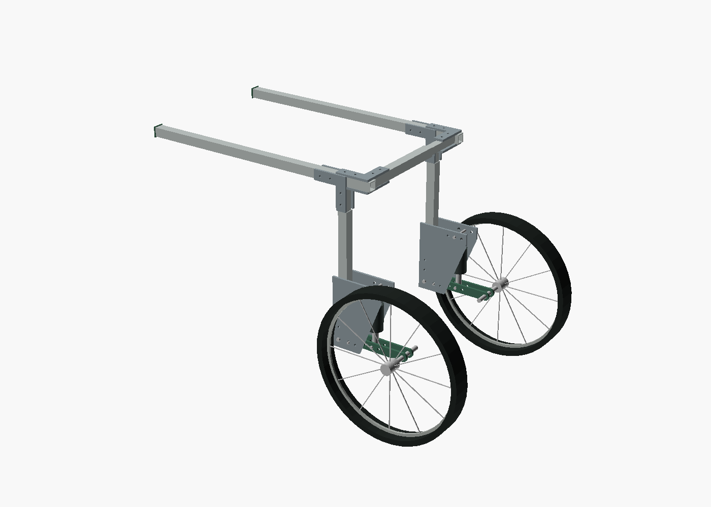

# Buddy Wheels mechanical design r0

**BENCH PROTOTYPE. NOT FOR USE ON AN ANIMAL.** Created November 8, 2026.

This is an actual editable CAD and mesh package, starting with the XL rig inspired by Buddy. His owner reports 140 lb (63.5 kg) and authorized a configurable estimate. It is not fitted to Buddy: his supported posture, dimensions, veterinary restrictions and printer are still unknown. The dimensions below are explicit design assumptions. There is no load rating, validated print process, structural analysis, physical test or animal-use approval.

Start with [the XL assembly guide](../../../docs/engineering/xl-assembly-r0.md), [the manufacturing drawing notes](../../../docs/engineering/wheelchair-drawings-r0.md), and [print instructions](../../../docs/engineering/wheelchair-printing-r0.md). [The engineering research](../../../docs/engineering/wheelchair-cad-research.md) records supplier evidence and unresolved interfaces.

The [website's wheelchair design studio](https://buddywheels.org/design-studio) can inspect the actual meshes, adjust the XS through XL family geometry, the three frame dimensions and suspension pose, and download a kit with matching dimensions and instructions. Frame-only changes retain these printable part shapes. The live studio does not validate loads or fit.

## Files you can use now

| Folder | Contents |
| --- | --- |
| [XL](XL/) | First detailed rig: editable CAD, ten STL types, three metal DXF profiles, assembly/detail/exploded images, BOM, kinematics and export hashes |
| [L](L/), [M](M/), [S](S/), [XS](XS/) | Separate parameter sets, corresponding exported parts, BOMs and images. Independent rig variants, not scaled STL files or validated fit ranges |
| [source/wheelchair.scad](source/wheelchair.scad) | Shared constructive-solid CAD, millimeters |
| [Buddy measurement worksheet](../../../docs/engineering/buddy-xl-measurements.md) | Inputs needed before an individualized XL revision |

Each family's `stl/` contains seven printable nonstructural/fixture types, plus three files prefixed `FIT_CHECK_ONLY_`. Those three represent primary structural plates and must be metal before any engineer-approved loaded bench testing. Their matching DXFs describe flat fabrication profiles. They are not approved production drawings. All STL geometry is at 1:1 millimeter scale, oriented for printing as exported. Slicers which ask units must use mm. Do not scale a file to fit a printer or a dog.



The CAD shows a mechanical rig with generic wheels and shock envelopes. It deliberately has no dog, fitted textile sling, complete guards, supplier-specific controls, load labels or marketing claims. The photographed-looking marketing renders elsewhere in this repo are separate concept art, not these drawings.

## Architecture

A U-frame uses square aluminum rails, telescoping uprights and a telescoping rear width bridge. Paired metal corner cheeks and positive through-bolts connect it. Each wheel has a paired metal trailing arm on a retained pivot, a purchased spring/damper, a slotted mechanical travel stop, and a neutral-position lock pin independent of the damper. Nonstructural caps, witness collars and tooling are printable. No printed spring, axle, load-bearing clamp, primary harness anchor or shock mount is specified for animal use.

Three matched upper/lower mounting positions change suspension leverage. There is no combined rehabilitation dial. Spring rate or air pressure, preload where applicable, damping, harness support and frame height are distinct controls. No pressure, spring rate, torque, treatment schedule or animal-use setting is supplied by r0.

## Nominal rig dimensions

All dimensions are mm. Height is rail **centerline**, not a prescribed groin or pelvic height. Width is distance between rail centerlines. Wheel offset is outward from the local upright centerline.

| Family | Rail length | Rail centers | Rail height | Wheel OD | Outer / inner square tube | Shock full / stroke / installed | Arm length |
| --- | ---: | ---: | ---: | ---: | --- | --- | ---: |
| XL | 680 | 400 | 620 | 400 | 25x2 / 20x2 | 165 / 38 / 155 | 180 |
| L | 600 | 340 | 500 | 350 | 25x2 / 20x2 | 165 / 38 / 155 | 165 |
| M | 460 | 280 | 380 | 300 | 22x1.5 / 18x1.5 | 140 / 28 / 130 | 140 |
| S | 340 | 210 | 260 | 200 | 20x1.5 / 16x1.5 | 100 / 20 / 92 | 100 |
| XS | 260 | 160 | 220 | 120 | 16x1.5 / 12x1.5 | 75 / 12 / 70 | 70 |

These five nominal assemblies do not establish coverage of the website's entire proposed size bands. XS/S low-legged variants, total device mass and suitable low-force shock availability especially remain unresolved. A dog does not qualify by matching a catalog weight band.

## Regenerate with Stacks

From the application root:

```sh
./buddy design:wheelchair
./buddy design:wheelchair --size XL --export --openscad /absolute/path/to/OpenSCAD
./buddy design:wheelchair --size all --export --openscad /absolute/path/to/OpenSCAD
./buddy design:wheelchair --profile designs/wheelchair/profiles/buddy-xl-estimate.json --export --openscad /absolute/path/to/OpenSCAD
./buddy design:wheelchair --bundle
./buddy test
```

The app-native command and typed parameters live in `app/Commands/DesignWheelchair.ts` and `app/Designs/Wheelchair.ts`. Bun writes CAD, BOMs, kinematics and hashes. JSON profiles export independently under `designs/wheelchair/iterations/<id>`; the Buddy estimate is supplied and exported there. Use a new profile id to preserve an iteration. Stacks has no CAD solid-modeling kernel; the command invokes the official OpenSCAD CLI for CSG, STL, DXF and PNG export. It adds no web framework, ecommerce service or runtime application dependency. OpenSCAD is an external design workstation prerequisite, not a server/deployment requirement. The binary is not committed.

`--bundle` uses Bun's native archive API to package the current exported designs, typed generator, tests and docs into `storage/framework/runtime/buddy-wheels-bench-r0.tar.gz`. It includes the whole design collection, even when a profile is selected. It does not rerender stale exports unless paired with `--export`. Run the tests after changing geometry and before making a new bundle. Environment files, provider credentials, runtime state and the CAD executable are outside its source allowlist.

Exports were made with official OpenSCAD 2021.01 on macOS. Its downloaded DMG matched the publisher SHA256 `4e4568e19992636ba497c04bc2238399c92314fcb7bf75dc3632aa623ca3635e`. See [official downloads](https://openscad.org/downloads.html). The design uses no external SCAD library. Editable source is SCAD, not STEP; no STEP export is claimed. A manufacturing engineer may remodel/review solids in their production CAD system before release.

The generator rejects nominal tube/eye/tire interference, insufficient overlap, arm-hole collisions and shocks reaching their stroke ends before the nominal stops. Export verification checks STL closedness, one connected body per file, positive volume, dimensions and hashes. These are digital geometry checks only. They do not establish strength, stability, fatigue life, tolerances, clearances under deformation or suitability for Buddy.

## Release boundary

Print the calibration coupon and empty fit-check rig first. Do not place Buddy or any other animal in it. The [existing validation gates](../../../docs/product/validation.md) still apply. Resolve exact shock/wheel/harness/fastener SKUs, tolerances, loaded motion/contact, fastener procedures and independent engineering review before a ballast test program. A veterinary rehabilitation professional must establish suitability and fit before any separately approved supervised animal evaluation.

The BOM is complete at the rig-interface level, including custom fabrication, hardware, softgoods and fixtures. It is not a purchase-ready kit: unresolved supplier selections and assembly torque procedures are explicitly marked. Suspension cost is not included in the storefront's wheelchair price. No sales gate or public capability claim changes in this CAD work.
