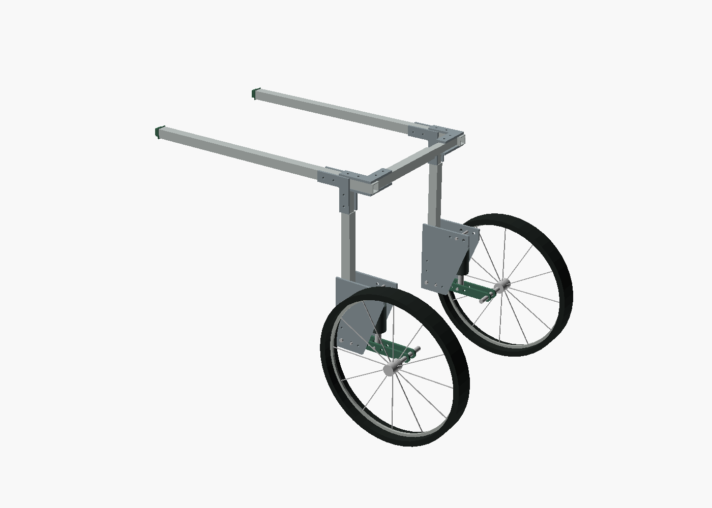
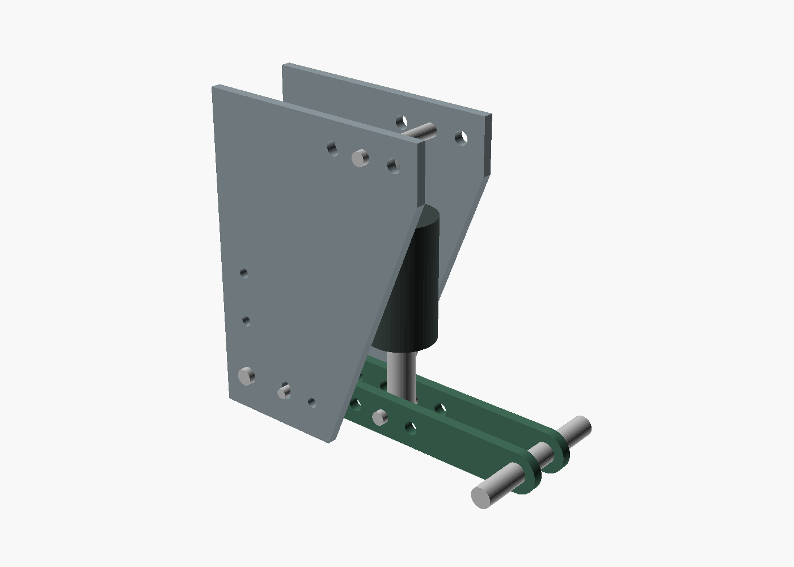
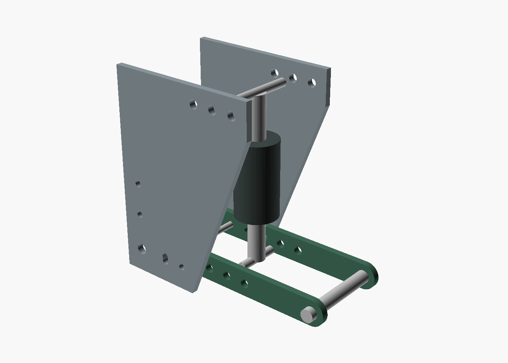

# Buddy's XL rig: assembly traveler r0

November 8, 2026. **Unloaded bench assembly instructions. Do not place Buddy or any animal in this prototype.** Buddy's owner reports 140 lb (63.5 kg); this is an input, not a design capacity. His other dimensions are provisional. Engineering sign-off, exact supplier parts and professional fitting remain outstanding.

Use [the complete XL BOM](../../designs/wheelchair/r0/XL/bom.csv), [tube hole schedule](../../designs/wheelchair/r0/XL/tube-drilling.csv), [fabrication notes](wheelchair-drawings-r0.md), and [printing guide](wheelchair-printing-r0.md). Every ID below refers to that BOM. Work on a stable bench with the assembly caught/supported. The suspension contains moving pinch paths and stored energy once a real spring is installed.

## Prepare the parts and tools

Print one coupon first, then 4 outer caps,1 inner cap,2 witness collars,4 sample pivot shields and 1 layout jig if needed. Four fixed-cheek,4 arm-cheek and 8 corner-cheek STLs are for empty fit checking only. Have a qualified shop fabricate metal counterparts using the DXF profiles after drawing review. Structural metalwork, bearings, spacers, pins, wheels, spring/dampers and textile supports are not printable substitutes.

Tools: calipers, machinist square, flat reference surface, clamps/soft jaws, appropriate drill press and metal jig/bush tooling, deburring tools, pin gauges, hand tools for selected hardware, calibrated torque tool after a procedure is approved, marker and a parts/inspection log. Keep fingers out of moving joints. Do not drill loose tubes in your hand. A printed layout jig is not final hole tooling.

Sort left/right rig parts but keep cheeks interchangeable. Count hardware against `bom.csv`. Verify tube cut lengths, section/temper, all hole coordinates and finish. Inspect plate edges and slot ends. Reject misalignment, distortion, sharp accessible edges, cracked prints and unknown structural substitutes. Do not preload a real shock to force misaligned mounts together.

## 1. Build the frame on the bench

1. Lay the two M01 side rails parallel. Front cut ends are X=-600; rear cut ends X=80. Their centerlines are 400 mm apart. Mark X=0, the upright/pivot datum, and X=60, the rear bridge datum.
2. At each rail's X=0 position, place M03 upper upright vertically. Its upper end touches the underside of the rail at Z=607.5, with rail center Z=620. It must not penetrate the horizontal tube. Use one M08 corner cheek on each side of the joint. The rail holes are X=-60,-30; upright holes are Z=590,560.
3. Install the four relevant flush crush sleeves at each side joint, H01 bolt sets, and 2.5 mm H06 spacers on both faces of the smaller upper tube at its two bolts. There are 4 through-bolts per side joint,8 total. Use actual bolts long enough for washers and full locknut engagement. Record bolt supplier/grade/length; do not adopt a generic guessed torque. Keep the empty rig on its fixture until the joint procedure is approved.
4. Assemble rear bridge M04/M05 between inner faces of the side rails at X=60. Each tube is 262.5 mm long; clear span between rail faces is 375 mm and overlap is 150 mm. The outer tube starts at the left rail; the inner tube ends at the right rail.
5. Place paired M08 corner cheeks above and below each bridge-to-rail joint. Their arms point forward along the side rail and inward along the bridge. Fit 8 more H01 bolt sets with flush crush sleeves. Add the remaining four H06 cheek spacers at the smaller right bridge tube. Check the bridge and rails remain square.
6. Match-drill and install the two H04 bridge index bolts/sleeves at the nominal center +/-15 mm, using the coordinate schedule. These are separate from the corner-joint bolts. Check both have positive locking hardware. A friction clamp is not the width lock.

## 2. Add the lower uprights

1. Slide each 315 mm M02 outer upright over its M03 inner section. At the nominal rig geometry the lower outer end is Z=225, its top Z=540, and inner-tube overlap 112.5 mm. Maintain the same height on both sides.
2. Match-drill the two index locations per side,20 and 50 mm below the outer tube top. Install the removable through-sleeves and H03 retained bolt sets. That is 4 height index bolts total. The two lower fixed-cheek attachment holes are 10 and 40 mm from the outer tube's lower end.
3. Install loose printed witness collars only as visible setup markers. They do not carry weight or retain height. No extra adjustment-hole rows are defined. Changing the nominal height requires a configured revision and overlap/hole/strength review.

## 3. Assemble each wheel suspension

1. Place 2 M06 fixed cheeks around the lower upright. The clear cheek gap is 48 mm; put 11.5 mm H05 metal spacers between each cheek and the 25 mm upright at each attachment bolt. Install 2 H02 bolt sets and flush tube sleeves per side. Both pivot holes are centered at X=0,Z=200.
2. Fit one S03 bronze pivot bush in each M07 arm cheek after the supplier's press/running fits are approved. The two arm cheeks have 20 mm between inner faces. Put the 20 mm S04 pivot spacer between them and an 8 mm S05 spacer outside each arm, between arm and fixed cheek. Insert S02 pivot pin through the complete 60 mm stack. Fit its end washer and positive cotter retainer. Do not use a friction cap as retention.
3. Align the two arm cheeks horizontally at neutral, with axle holes at X=180,Z=200. Insert S07 neutral lock pin through both fixed cheeks, both arms and its 20 mm S09 arm spacer. Fit washer/cotter. Support the empty rig independently; the lock is not yet a rated load-bearing support.
4. At arm radius 30 mm, insert the S06 stop pin through one fixed slot, both arm holes with 20 mm S08 spacer, and the opposite slot. Fit washer/cotter without squeezing the slot faces together. The pin must move in both slots when unlocked. The nominal arc centerline runs -3 to +6 degrees, with clearance/wear still to be evaluated.
5. Fit the selected spring/damper only after its complete drawing and tune are approved. For an empty visual fit check, use a clearly marked non-load-bearing dimensional dummy instead. Requested XL interface is 165 mm extended eyes,38 mm stroke,155 mm neutral installed eyes,8 mm eye bore,20 mm eye width, maximum 40 mm body envelope. No verified purchasable unit is released by this BOM.
6. For initial empty-rig geometry use matched upper/lower middle holes, radius 90 mm. The upper eye is X=90,Z=355; the lower eye X=90,Z=200. Use two 14 mm S10 upper eye spacers with S11 pin. S12 lower pin connects the eye between the paired arm cheeks. Check actual eye clearance and articulation rather than forcing nominal 20 mm parts into an interference fit. Follow the selected supplier's retention instructions after review.
7. Repeat on the other side. Use the same numbered setting on both sides for the symmetric reference rig. Check both sides for misassembly and note independent-wheel roll is still an open system risk.

## 4. Fit wheels and nonstructural prints

1. For each wheel, install W03 center spacer between the arm cheeks at the axle, then W04 outboard spacer 34 mm long and the specified 40 mm hub/bearing stack. Pass W02 headed 12 mm axle through the 106 mm total stack. Add end washer and positive cotter. The wheel center is 70 mm outward from the upright centerline. Confirm the actual hub's internal bearing spacer and endplay, not just its outer width.
2. Confirm both wheels turn without catching plates, pin ends or retainers. Nominal tire centers are 540 mm apart and overall tire envelope 590 mm. Exact loaded tire radius, wheel bearings, tire pressure and capacity remain supplier/test inputs.
3. Fit caps only to compatible open tube ends where they do not obstruct fasteners or inspection. The supplied quantities include spare protection pieces, not a requirement to cap telescoping entries. Sample pivot shields are removable rig covers and do not provide complete fur/toe/pinch protection. They are not fastener locks. Remove any sample cover that can touch a moving part or hide inspection.
4. Do not invent a textile support from a printed cradle or unqualified strap. T01/T02 are professionally selected padded softgoods and verified attachment/routing interfaces. Harness anchor hardware and its load path remain a fitting/engineering dependency, so the r0 rig is intentionally not a wearable finished wheelchair.

## 5. Understand and change suspension settings on the empty rig

Fully support the frame before removing a lock pin, shock pin or spring component. Unload and isolate the shock according to its manufacturer. Never move a live preload collar or eye pin under supported load. Keep the pin retainers accounted for.

| XL matched hole setting | Upper and lower radius | Ideal wheel rate / shock rate at neutral | Relative wheel stiffness |
| --- | ---: | ---: | ---: |
| A,0 | 70 | 0.151 | 1.00 |
| B,1 | 90 | 0.250 | 1.65 |
| C,2 | 110 | 0.373 | 2.47 |

The ideal small-motion relationship is `k_wheel = k_shock * (r/180)^2` for the neutral linkage. It ignores friction, gas progression, damper breakaway, tire compliance, flexibility and changes with angle. It is not a measured ride-quality result. Higher radius increases ideal wheel stiffness for the same spring, so softer/firmer geometry is configurable without confusing preload with rate.

Move **both** upper and lower shock eyes to the same radius; do not mix 70/90/110 holes. Reinstall correct spacers/pins/retainers and sweep motion by hand, using no animal or added ballast. The sampled nominal range gives 18.8 mm wheel bump and 9.4 mm droop around neutral. Generated `kinematics.json` records eye distance at each endpoint. All positions must avoid the shock's real hard ends and controls, accounting for tolerances. Do not force a pressurized unit through travel by hand against unsafe stored energy.

The separate neutral lock pin fixes the arm at the datum. It is a positive geometric lock, not proof of rated fail-safe support. A shock's hydraulic lockout is not its substitute. This open r0 concept has no verified redundancy after spring failure: it can settle onto a stop, and that consequence must be tested/reviewed. Do not call any setting a rehab, training, running or all-terrain mode.

Actual rear support force must be measured separately in an approved fixture and professionally selected harness.140 lb total body mass does not imply 70 lb at the rear or 35 lb per shock. Suspension softness cannot prescribe how much weight Buddy places on his hind legs.

## 6. Inspect and record before any next gate

Record part revisions/lots, actual cut/hole/stack measurements, supplier selections, bolt/retainer inventory, symmetric settings, unloaded wheel rotation, sweep interference, frame squareness and sharp edges. Account for every critical pin, sleeve, washer, cotter and locknut. Retain pictures of both sides and the underside. A complete empty fit check is not a proof test.

Do not add ballast until an independent mechanical engineer has closed drawings, supplier interfaces, fastener procedure, stop/lock behavior, guarded-motion requirements and a written load/test protocol. The engineer must choose static, fatigue, one-wheel impact, tip/rack, failure and environmental tests and acceptance criteria. Run the fixed/locked reference before comparing suspension. Stop on any binding, loosening, yielding, cracking, retainer movement, unexpected settling or instability.

Only after the relevant bench gate passes may the veterinary rehabilitation professional consider individual fitting and a separately approved supervised evaluation. No time schedule, terrain envelope or safe operating load has been established for this design.
